

LT GEN MS SODHI MEDAL · DATA ANALYTICS COMPETITION 2026 · ANALYSIS REPORT · TEAM FCE

CONFLICT WATCH

When and where will conflict deaths rise next, and what does it mean for India?

Maj Shivam Mehta · Capt Siddharth Sangwan · Capt Sahil Singh · Data to 30 Sep 2026 (UCDP), 12 Nov 2026 (GDELT) · Issued competition data only · Run CW-F6C2C2CC

**Bottom line.** Russia–Ukraine stays **RED** (about 6,780 deaths in Oct 2026). Afghanistan–Pakistan is **AMBER** and is the front that matters most to India: Pakistan now fights the TTP inside and Afghanistan across the Durand Line. US–Iran and Israel–Hamas are **GREEN** on the monthly model, but US–Iran is a "sudden war": history cannot forecast its onset, so a daily news tripwire watches it. Our forecast cut error by **29%** against "no change" on withheld 2026 data (90% interval 2% to 41%); the area watch-list is **4.1×** better than chance.

**Act now.** (1) Task ISR on the monthly top-10 areas (Kandahar, Kunar, Kabul lead). (2) Treat any J&K attack with 15+ deaths as the start of a 15-day escalation watch. (3) Keep Gulf evacuation plans current and act the day the tripwire turns RED, not when deaths are published six weeks later.

| Conflict | Oct 2026 | Forecast deaths | 80% range | vs last 6 months | Top watch area |
|---|---|---|---|---|---|
| **Russia–Ukraine** | <b class="red">RED</b> | 6,780 | 3,316–16,708 | +7% | Chernihiv (16%) |
| **Israel–Hamas** | <b class="green">GREEN</b> | 128 | 62–317 | -4% | West Bank (14%) |
| **Afghanistan–Pakistan** | <b class="amber">AMBER</b> | 318 | 155–786 | +12% | Kandahar (25%) |
| **US–Iran** | <b class="green">GREEN</b> | 26 | 12–66 | -78% | Hormozgan (13%) |

## 1 · Problem understanding

The brief is open: frame our own questions from four conflicts. We framed it as **decision support for India** and asked five questions, each tied to a decision. **Q1** How intense is each war and where is it heading (force posture, watch levels)? **Q2** Which areas will escalate next month (ISR tasking)? **Q3** Can we see a change of state before deaths are published (warning time)? **Q4** How far can the record be trusted (confidence in Q1–Q3)? **Q5** What touches India: the Pakistan front, the Gulf and the sea lanes? Every claim of predictive skill had to survive data the model had never seen: **all of 2026 was withheld** from every modelling choice.

## 2 · Data preparation and feature engineering

**Twelve issued files, one rule: providers are never joined on event IDs.** Cross-provider keys are only country and day, week, month or year; the pre-joined panels (D11–D12) are audited, not trusted (the supplied panel shows 0 UCDP deaths for 2026, so we rebuilt from events).

| ID | Issued file | Rows | Period | Use |
|---|---|---|---|---|
| D1 | conflict_events (UCDP GED 26.1 + Candidate 2026) | 61,055 | Jan 2014 – Sep 2026 | Fatality ground truth; models; 2026 withheld |
| D2 | event_sources | 85,406 | 2014 – Oct 2026 | Source dependence; reporting lag (§3.5) |
| D3–D5 | UNHCR stocks, demographics; IDMC/UNRWA | 26,215 | 2014 – 2025 | Displacement, HADR planning |
| D6 | country_year_context (World Bank) | 1,764 | 2014 – 2025 | Population, growth, inflation (lagged) |
| D7–D8 | GDELT focus files (two) | 13,507,238 | Feb – Nov 2026 | Attention; daily tripwire (§4.4) |
| D9 | Middle East weekly (ACLED-style) | 149,825 | Dec 2014 – Jun 2026 | Second source; Gulf spill-over |
| D10 | UCDP GED long file | 200,000 | 1989 – 2025 | Transfer learning (§4.5); India's front (§3.3) |
| D11–D12 | Pre-joined country panels | 3,467 | 1989 – Jun 2026 | Audited, used only for checks |

**Cleaning.** 36 checks are logged with the rows affected and the action (code: `src/cleaning.py`); 23 found something. The ones that change results:

| ID | Issue | Rows | What we did |
|---|---|---|---|
| DQ05 | Out-of-order low/best/high estimates (low<=best<=high violated) | 692 | Raw values preserved |
| DQ07 | Event date range crosses a month boundary | 731 | Fatalities allocated across months in proportion to days in range (uniform-day disaggregation) instead of assigning everything to the start month. |
| DQ10 | Provisional UCDP Candidate records (Jan-Sep 2026) | 4,644 | Flagged is_provisional |
| DQ13 | Administrative boundary change: FATA merged into Khyber Pakhtunkhwa (2018) | 602 | Harmonised FATA to 'Khyber Pakhtunkwa province' (post-merger boundary) for a stable sub-national panel; raw admin1_name retained. |
| DQ14 | Blank admin1_name | 3,043 | Imputed category '(country-level / unspecified)' so the events remain in sub-national panels. |
| DQ15 | Aggregate event records (event_clarity = 2) | 5,757 | Kept (they carry real deaths) and flagged; event COUNT features use clear events only. |

**Imputation.** Months with no UCDP event are true zeros (UCDP is an event register). Blank areas become an explicit "(country-level / unspecified)" level, never a guessed place. The GDELT gap of 1–16 May 2026 stays missing. World Bank gaps are interpolated inside each economy only, and lagged one year so a forecast never sees the future. Raw values are never overwritten: corrected copies sit beside them.

**Features** (all known at the end of the forecast month): recent level (log deaths now, 1 and 2 months ago), rolling means (3, 6, 12 months, exponential), volatility and 12-month peak, momentum (3 vs 12 months) and acceleration, months since the last death, reporting intensity (events, sources), seasonality and horizon. The area model adds the parent conflict's tempo, the country's tempo and the area's share of its conflict. A 40-feature set with displacement and macro data overfit and was dropped (ablation in §4).

## 3 · Exploratory analysis and insights

Each finding ends in a **deduction** and an **action**.

**3.1 Four wars, four shapes.** Russia–Ukraine holds 81% of 554,396 recorded deaths and is flat at 6–8k a month; Israel–Hamas fell 92% after the Oct 2025 ceasefire; Afghanistan–Pakistan has already passed its 2025 total (2,767 vs 2,649); US–Iran recorded 3,965 deaths in 2026, mostly in 39 days from 28 Feb. Civilians are 49% of Israel–Hamas deaths against 7% in Russia–Ukraine. *Deduction:* one watch level cannot fit all four. *Action:* attrition watch for RU–UA, onset watch for US–Iran, standing watch for Af–Pak.

<figure>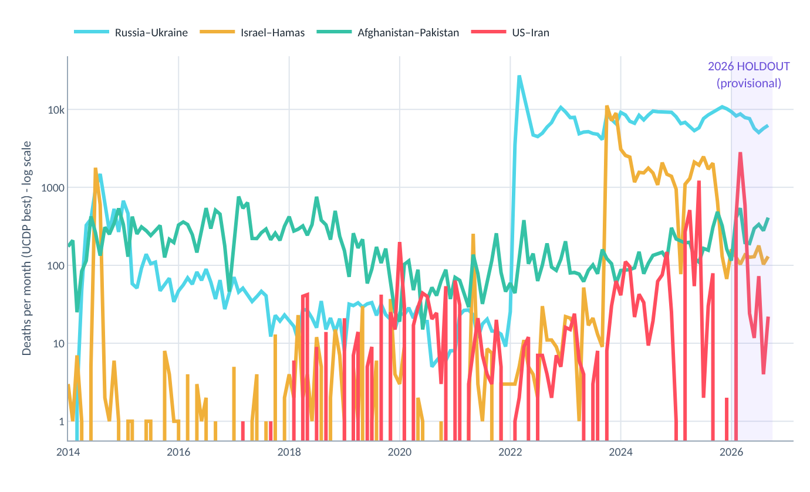<figcaption>Monthly deaths by conflict, log scale; shaded = 2026 withheld test window [D1]</figcaption></figure><figure>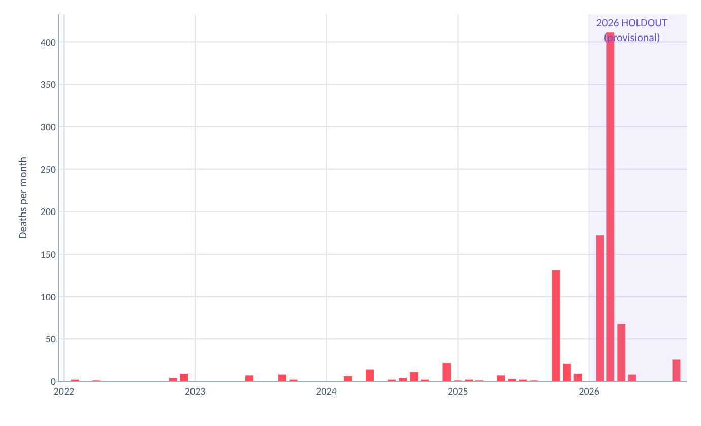<figcaption>Afghanistan–Pakistan: state-on-state deaths since Oct 2025 [D1]</figcaption></figure>

**3.2 Pakistan now fights on two fronts.** TTP violence in Khyber Pakhtunkhwa grew every year since 2021, and since Oct 2025 the two governments fight each other directly (peak 411 deaths in Mar 2026). FATA was merged into KP in 2018; we harmonised the 602 affected records (DQ13) so the area series do not break. *Deduction:* a stretched Pakistan raises the risk of miscalculation on the LoC. *Action:* treat Af–Pak hotspots as a standing LoC indicator.

<figure>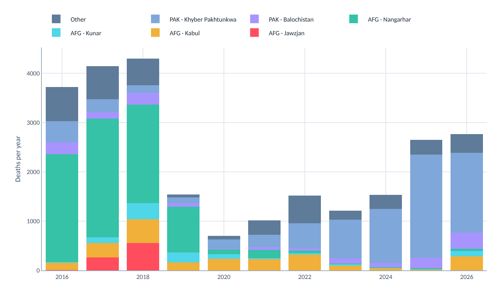<figcaption>Af–Pak deaths by province: KP and Balochistan carry the rise [D1]</figcaption></figure><figure>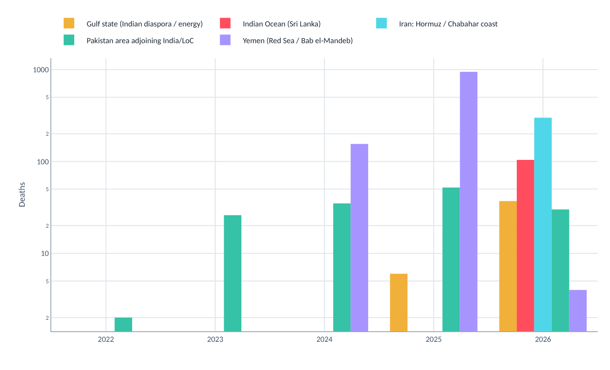<figcaption>Where the four wars touch India: LoC-adjoining areas, Gulf, Hormuz, Sri Lanka [D1]</figcaption></figure>

**3.3 India's own front: a 15-day clock.** From D10, every J&K incident with 15+ deaths since 2014 (7 incidents). After Uri, Pulwama, Pahalgam, India–Pakistan state fighting with 30+ deaths followed within 11–15 days; state deaths had been near zero in the 45 days before. D10 keeps only the deadlier records outside the focus countries, so these are floors, and cross-border firing was routine in 2016–20: a pattern to watch, not proof of cause. *Action:* start a 15-day escalation watch after any such attack.

**3.4 The 2026 war reached India's neighbourhood.** US–Iran deaths were recorded in 14 countries in 2026 (4 in 2025), including 5 Gulf states and 104 killed off Sri Lanka on 4 Mar 2026. The ACLED-style file (D9) shows Gulf violent events rising from 9 to 322 (H1 2025 to H1 2026). *Action:* keep Gulf evacuation plans and sea-lane escorts tied to the tripwire.

**3.5 The record arrives late, and unevenly.** Only 40% of Russia–Ukraine deaths are known 90 days after the event, against 93% for Af–Pak (D2 publication dates). *Deduction:* the 2026 Russia–Ukraine "decline" is mostly late reporting. *Action:* read recent months as a floor; never brief a fall in RU–UA deaths from the last quarter alone.

**3.6 News follows politics, not deaths.** US–Iran drew 781 GDELT articles per death against 25 for Russia–Ukraine. Weekly news moves with deaths only for Af–Pak and US–Iran (ρ 0.93 and 0.86). *Action:* use news to see a change of state, never to size a war (§4.4).

<figure>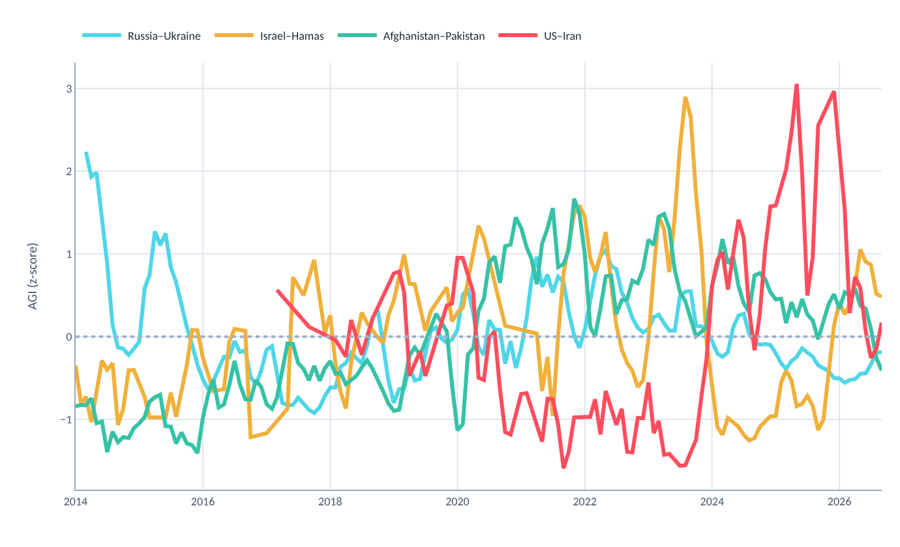<figcaption>Attention vs deaths: source references per 100 deaths [D1, D2]</figcaption></figure><figure>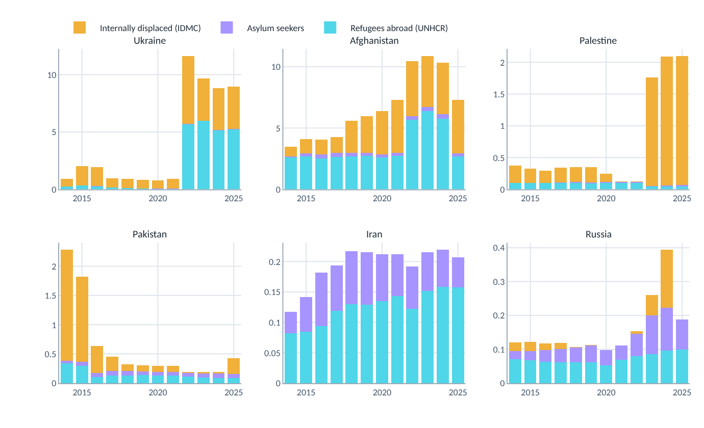<figcaption>Displacement by origin: refugees abroad and IDPs [D3–D5]</figcaption></figure>

## 4 · Model and prediction

**4.1 Protocol.** Walk-forward: for each year Y the models are fitted on data to Dec Y−1 and scored on Jan–Sep of Y (back-test 2022–2025, holdout 2026). Choices were made on the back-test only.

**4.2 Choice and justification.** Four series of about 150 months each are too few for a deep model. We combine three members with different errors: a 3-month mean (robust), damped ETS on log deaths (each war's own trend) and **LightGBM-Δ**, one model pooled across the four wars that predicts the *change* in log deaths with an L1 loss. The Δ target and compact features won the ablation (back-test RMSLE 0.902 vs 1.232 for the default ML set-up). The ensemble is the log-space mean. SARIMA was tested and not selected on the back-test. Bands are split-conformal, built from the models' real past errors.

**4.3 Performance on withheld 2026 data (1 month ahead).**

| Model | RMSLE | MAE cut vs naive | 90% interval | Diebold–Mariano p | 80% band coverage |
|---|---|---|---|---|---|
| Ensemble (adopted) | 0.845 | 29% | 2% to 41% | 0.053 | 81% |
| No change (naive) | 0.961 | – | – | – | – |
| ETS alone | 0.897 |  |  |  |  |
| LightGBM-Δ alone | 0.908 |  |  |  |  |

By conflict the cut is RU–UA 30%, IL–Hamas 55%, Af–Pak 4%, US–Iran 31%. **Reliability:** the forecast is good for protracted wars one month ahead; bands widen fast beyond that, and US–Iran's onset fell outside its band (22% coverage). That limit is why §4.4 exists.

<figure>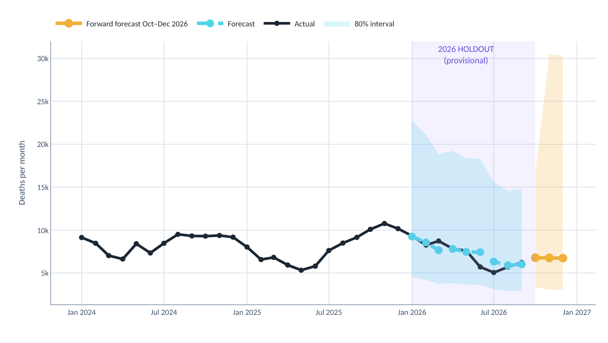<figcaption>Russia–Ukraine: 1-month forecasts on withheld 2026, 80% band, forward forecast</figcaption></figure><figure>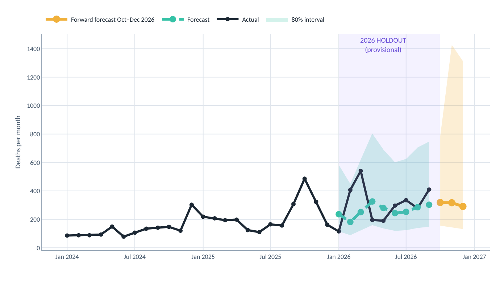<figcaption>Afghanistan–Pakistan: same view</figcaption></figure>

**4.4 The fast clock: a news tripwire for a change of state.** RED fires when violent GDELT events per day reach 4× their 14-day median (and at least 100); AMBER when military-posture reports reach 4× their 28-day median. Rules were fixed before testing and not tuned. Of 5 RED alerts in Feb–Sep 2026, **4 were confirmed** by a UCDP escalation within ±3 days (chance: 1.6; permutation p = 0.018). US–Iran: AMBER on 2026-02-25, RED on 28 Feb, the first day of the war; UCDP published those deaths weeks later. It misses most routine insurgent escalations (Af–Pak 5 of 21 days), so it complements the forecast, it does not replace it.

<figure>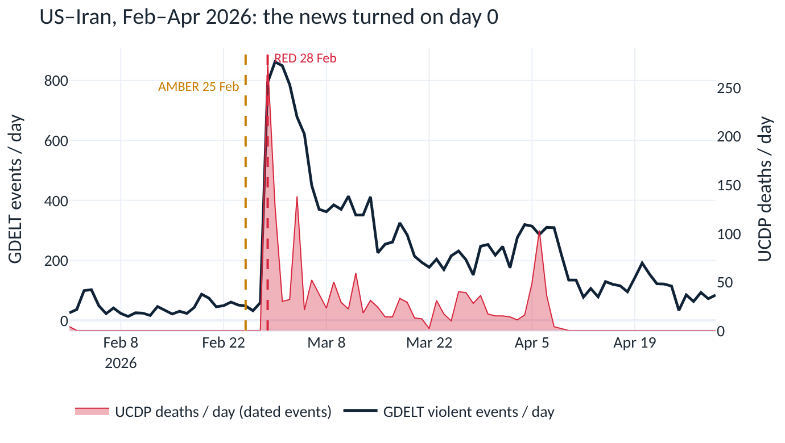<figcaption>US–Iran tripwire: AMBER and RED lines against UCDP deaths [D7, D8, D1]</figcaption></figure><figure>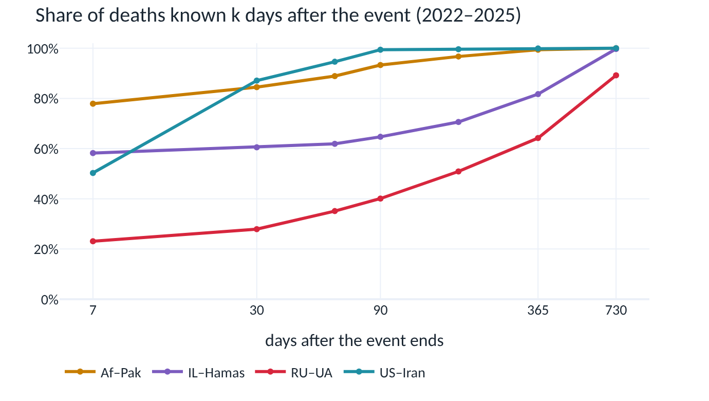<figcaption>How much of the record is known k days on [D1, D2]</figcaption></figure>

**4.5 Where next: the area escalation warning.** An area escalates if next month's deaths are ≥ 10 and ≥ 1.5× its 3-month mean (about 4% of area-months). A LightGBM classifier ranks 222 areas in 22 countries. **New in v2: transfer learning.** The four cases hold too few escalations to learn from, so the classifier also trains on 1,450 areas in 110 other countries from D10 (1990–2025, focus countries removed to avoid double counting). The variant was **pre-registered**: chosen on the 2023–25 back-test by a rule written before 2026 was scored (file hash `8700f6dc157c…`).

| Escalation model | Back-test PR-AUC | Back-test ROC-AUC | 2026 PR-AUC | 2026 ROC-AUC | 2026 top-10 precision |
|---|---|---|---|---|---|
| Competition-day model (cases only) | 0.208 | 0.853 | 0.133 | 0.795 | 14.4% |
| **v2: cases + world areas (pre-registered)** | **0.241** | **0.862** | **0.146** | **0.798** | **16.7%** |
| Rule: rank by last month's deaths |  |  | 0.088 | 0.727 | 4.4% |

Base rate 4.1%, so the top-10 list is 4.1× better than chance. After scoring we added Platt calibration fitted on the back-test only, because the larger model over-stated probabilities above the scorecard's 15% hotspot line; it does not change the ranking, and the file records that it was added after seeing 2026. **Sealed claims:** the Oct–Dec 2026 forecasts and the watch-list are hashed (`d215dfe6cbf7c416…`) so they can be scored when UCDP publishes.

<figure>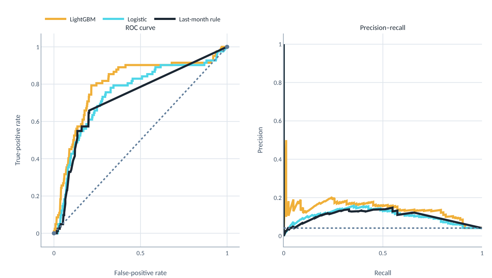<figcaption>Escalation warning on 2026: ROC and precision–recall vs the rule of thumb</figcaption></figure><figure>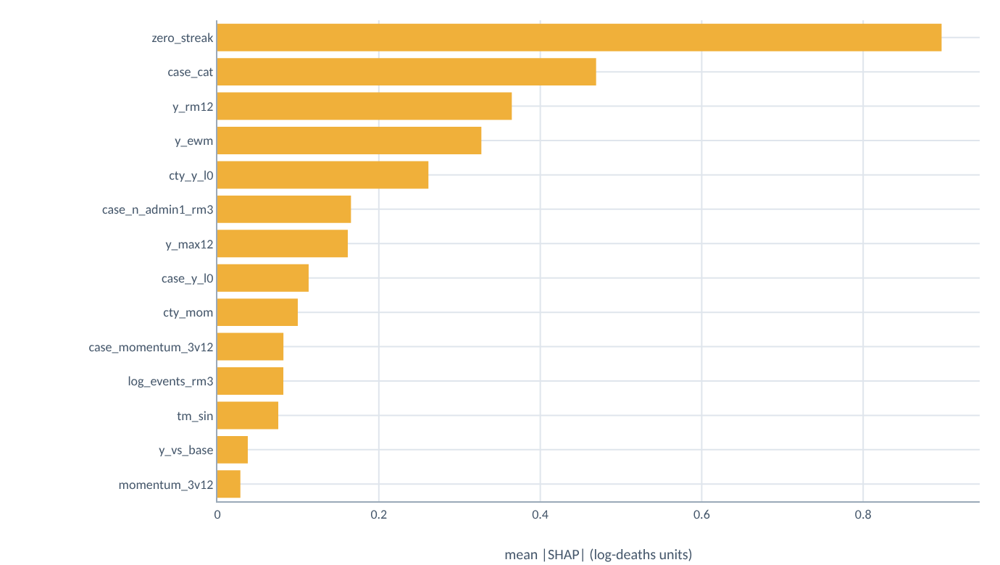<figcaption>What drives the warning (mean |SHAP|)</figcaption></figure>

**4.6 The scorecard.** Points: intensity (forecast ≥1,000 → 2; ≥100 → 1), trend vs the last 6 months (≥+20% → +1; ≤−20% → −1), hotspots (areas with P ≥ 15%: ≥3 → 2; ≥1 → 1), spread (more countries than last year → 1) and volatility (a 1,000-death month in the last year → 1). **RED** if the forecast is ≥1,000 deaths or points ≥5; **AMBER** if points ≥2; otherwise GREEN. US–Iran scores 1 (spread +1, volatility +1, trend −1): GREEN on the monthly rule, which is why the daily tripwire guards it. Rules are in the report, the code and the dashboard, and the dashboard re-checks its ratings against the pipeline on load.

## 5 · Innovation and tools

**Two clocks:** a monthly forecast sizes the war; a daily tripwire flags its change of state, each with its own test. **Transfer learning** from the wider world for a small-sample warning model. **Honest-by-design:** pre-registered model choice, sealed forecasts, a completeness curve that tells the reader when not to trust the latest month. **Ops site** (single offline HTML file and Streamlit app): a one-screen commander view with CDS and two notional theatre views, three depths of detail, an Ops console (brief, theatre, warning, map, area, forecast, what-if, scorecard, data quality) and the fast-clock panel. Python (pandas, LightGBM, statsmodels, scikit-learn, plotly), DuckDB for the 5.7 GB GDELT files, TypeScript/ECharts for the site.

## 6 · Recommendations

| Line | Action | Evidence | Trigger | Confidence |
|---|---|---|---|---|
| SENSE | Task ISR and analysts on the monthly top-10 areas; run the daily tripwire | Top-10 precision 17% vs 4% base rate; 4 of 5 RED alerts confirmed | Monthly list; RED alert | Medium |
| WARN | Treat Af–Pak hotspots and any J&K attack with 15+ deaths as LoC indicators; 15-day watch | §3.2–3.3: two-front Pakistan; 11–15 days to state fighting | Af–Pak AMBER/RED; J&K attack | Medium |
| SHIELD | Keep Gulf evacuation and sea-lane plans current; act on RED, not on published deaths | §3.4, §4.4: war reached 14 countries; tripwire fired on day 0 | US–Iran RED or AMBER | High |
| SUSTAIN | Plan Russian-platform spares on a long RU–UA war (DOMAIN) | RU–UA RED, 6–8k deaths a month, no sign of decline once late reports arrive | RU–UA stays RED | Medium |
| ADAPT | Brief recent months as floors; re-run when UCDP publishes Oct–Dec and score the sealed claims | Only 40% of RU–UA deaths known at 90 days | Each UCDP release | High |

## 7 · Limitations, reproducibility and AI declaration

**Limitations.** 2026 UCDP data are provisional and will rise. Four conflict series give small samples: one-month-ahead bands are usable, longer ones are wide. The tripwire rests on 5 alerts in 8 months. D10 is a capped extract that favours deadlier records outside the focus countries. GDELT counts reports, not incidents, and is US-heavy. Theatre commands in the site are notional. No outside data are used anywhere in this entry.

**Reproducibility.** One command, `python run_pipeline.py`, rebuilds every table, model and figure from the raw files in about 3–4 minutes (seed 42); `python scripts/export_web.py` rebuilds the site data and stops if any headline number drifts; `python scripts/check_submission.py` is the compliance gate (pages, names, files, declarations). Run ID `CW-F6C2C2CC` is a hash of the result tables and appears on every product.

**AI tools declaration.** The team used Anthropic's Claude (an AI assistant) to help write and debug code, draft text and design the site and slides. The team set the questions, made the design decisions and checked every number against the pipeline outputs.
